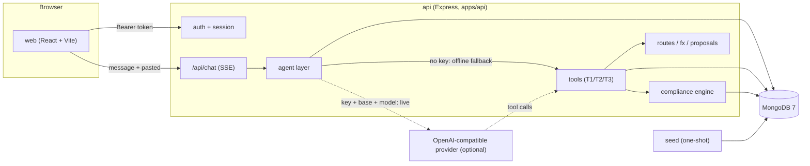

# Technical documentation

RemitWise (repo name `ChatroGent`) is a sandbox agent that helps a student plan
and draft a cross-border tuition payment. It is a monorepo: an Express + MongoDB
API with an agent layer, and a React web app. **All money movement is simulated**;
route and rate data are labelled sample data.

Numbers in this document come from the code, not from memory:

- **18 compliance rules** (`remitwise-seed/remitwise/data/compliance_rules.json`).
- Rule outcomes (the `Outcome` type in `apps/api/src/services/compliance.ts`):
  `pass`, `needs_documents`, `escalate_to_bank`, `blocked`.
- Rule statuses (`RuleStatus`): `enforced`, `not_enforced`, `not_applicable`.
- Tests: **6** unit (`test/unit.ts`), **28** agent (`test/agent.ts`), **34** smoke
  checks (`test/smoke.sh`).

## 1. System architecture



| Component | Location | Responsibility |
| --- | --- | --- |
| Web | `remitwise-web/src` | React UI: sign-in, chat (SSE), confirmation cards, dashboards, activity log. Dev proxy `/api` → `http://localhost:4000`. |
| API | `remitwise-seed/remitwise/apps/api/src/server.ts` | Express app; helmet, CORS allow-list, JSON body cap (10kb), rate limits, auth middleware, route mounting, `/api/health`. |
| Agent layer | `apps/api/src/agent/` | `loop.ts` (orchestration), `llm.ts` (providers), `fallback.ts` (offline deterministic flow), `tools.ts` (tool allowlist + implementations), `injection.ts`, `redact.ts`, `session.ts`, `audit.ts`. |
| Tools | `agent/tools.ts` | The eight tools and their permission tiers; argument validation; server-side beneficiary derivation. |
| Compliance engine | `services/compliance.ts` | Loads the 18 rules, builds a context from the DB, evaluates each rule, returns `decision`, `ruleResults`, `notEnforced`, `limits`. |
| Providers/adapters | `agent/llm.ts`, `provider.ts` | `LlmProvider` (OpenAI-compatible + scripted) and `MockPaymentProvider` (always succeeds unless forced to fail). |
| MongoDB | `infra/mongo-init/01-init.js` | Collections, validators, indexes, the least-privilege app role. |
| Seed | `apps/api/src/seed.ts` | Idempotent seed: 4 users, accounts, documents, routes, FX, 18 rules. |

## 2. Data model

Collections created and validated in `infra/mongo-init/01-init.js`; documents
written by `apps/api/src/seed.ts` and the routes/services.

| Collection | Key fields | Notes |
| --- | --- | --- |
| `users` | `email`, `name`, `kycTier`, `passwordHash` | `passwordHash` is `salt:scryptHex` (`seed.ts` `hashPassword`, verified in `auth.ts` `verifyPassword`). |
| `accounts` | `userId`, `currency`, `balance`, `label` | One per currency (`BDT`, `MYR`). |
| `student_files` | `institution`, `estimate.totalUSD`, `estimate.academicYearMonths`, `level`, `bankBranchId`, `payerName`, `invoicePayerName` | Feeds `PURPOSE_02`, `AMT_01`, `AMT_02`, `BANK_01`, `PAYER_01`. |
| `documents` | `userId`, `type`, `status` | Required set: `application_form`, `admission_letter`, `cost_estimate`, `passport`, `certificates`. Feeds `DOC_01`. |
| `proposals` | `status`, `payloadHash`, `quoteSnapshot`, `rulesVersion`, `expiresAt` | `status` enum `pending, confirmed, cancelled, expired, executed`; `payloadHash` is sha256 over canonical input + userId (`services/proposals.ts` `payloadHashOf`, written by `createProposal`; the card surfaces the same value as `approvalHash`). |
| `transfers` | `userId`, `proposalId`, `status`, `amountBDT`, `quoteSnapshot`, `receiptId` | `status` enum `pending, completed, failed, reversed`. |
| `alerts` | `userId`, `pair`, `target`, `fallbackDate`, `status` | Created `proposed`; activation is a UI action. |
| `audit_log` | `ts`, `rulesVersion`, `component`, `decision`, `event`, `tier`, `outcome`, `userId`, ... | `tier` enum `T1, T2, T3, SYS`. Insert/read only — see the append-only note below. |
| `routes` | `corridor`, `provider`, `feeBDT`, `spreadPct`, `etaDays`, `sourceUrl`, `dateCollected`, `dataType` | Loaded from `data/routes.csv`. |
| `fx_rates` | `pair`, `date`, `rate` | Loaded from `data/fx_history.csv`. |
| `compliance_rules` | `ruleId`, messages | Loaded from `data/compliance_rules.json` (18 rules). |

**Append-only audit.** `infra/mongo-init/01-init.js` grants the app role
`find` and `insert` only on `audit_log`. `evidence/audit-log-append-only.md`
records the verification: as the API's own DB user, `updateOne` and `deleteOne`
both fail with MongoDB error 13, and the document count is unchanged.

## 3. API endpoints actually implemented

From `server.ts` and `apps/api/src/routes/*`.

| Method + path | Auth | Purpose | Source |
| --- | --- | --- | --- |
| `GET /api/health` | no | `{ ok, db }`, pings Mongo | `server.ts` |
| `POST /api/auth/login` | no | Email + password → bearer token (1 h) | `routes/auth.ts` |
| `GET /api/me/balances` | yes | Account balances | `routes/me.ts` |
| `GET /api/me/student-file` | yes | Student file | `routes/me.ts` |
| `GET /api/me/documents` | yes | Document types + status | `routes/me.ts` |
| `GET /api/me/profile` | yes | Tier, meaning, caps, rules version | `routes/me.ts` |
| `GET /api/me/dashboard` | yes | Aggregated dashboard | `routes/me.ts` |
| `GET /api/routes/compare` | yes | Ranked route quotes | `routes/routes.ts` |
| `GET /api/fx/window` | yes | Best/worst/current/average for a pair | `routes/fx.ts` |
| `GET /api/fx/:pair/history` | yes | Full rate history | `routes/fx.ts` |
| `GET /api/alerts`, `POST /api/alerts` | yes | List / create a proposed alert | `routes/alerts.ts` |
| `GET /api/audit` | yes | Last 100 audit rows for the user | `routes/audit.ts` |
| `POST /api/compliance` | yes | Run the engine for an amount/corridor | `routes/compliance.ts` |
| `POST /api/proposals` | yes | Create a proposal (compliance-gated) | `routes/proposals.ts` |
| `POST /api/proposals/:id/confirm` | yes | Single-use confirmation | `routes/proposals.ts` |
| `POST /api/proposals/:id/cancel` | yes | Cancel a pending proposal | `routes/proposals.ts` |
| `GET /api/proposals/:id` | yes | Read a proposal | `routes/proposals.ts` |
| `POST /api/chat` | yes | SSE agent turn: `meta`, `tool_call`, `tool_result`, `card`, `text`, `done` | `routes/chat.ts` |

Rate limits (`server.ts`): 100 requests/min overall, 10/min on login, 30/min on
confirm, and 20/min on chat (`routes/chat.ts` `chatLimiter`, keyed by
`req.user.sub`).

## 4. Core algorithms

### 4.1 Corridor conversion and net amount

`services/convert.ts`. Every corridor has one destination currency and one rate
pair, with no cross-currency fallback:

```ts
export const CORRIDOR_META = {
  'BD-MY': { dest: 'MYR', pair: 'MYR/BDT', label: 'Malaysia' },
  'BD-US': { dest: 'USD', pair: 'USD/BDT', label: 'United States' },
  'BD-UK': { dest: 'GBP', pair: 'GBP/BDT', label: 'United Kingdom' },
  'BD-CA': { dest: 'CAD', pair: 'CAD/BDT', label: 'Canada' },
  'BD-AU': { dest: 'AUD', pair: 'AUD/BDT', label: 'Australia' },
};
```

`computeQuote(amountUSD, usdPerBdt, pairRate, feeBDT, spreadPct, ...)`:

```
grossBDT = amountUSD × usdPerBdt
gross    = grossBDT / pairRate
feeDest  = feeBDT / pairRate
net      = (gross − feeDest) × (1 − spreadPct/100)
quotable = net > 0
```

`corridorRate` returns `null` when the corridor is unknown or either leg has no
rate on file; the caller then refuses the quote instead of quoting another
currency.

**Worked example (real run, Flow 1).** Input: send BDT 2,40,000 in BD-MY.
Rates: `USD/BDT = 122.85`, `MYR/BDT = 29.10`. Best route: fee `2500 BDT`,
spread `1.5%`.

```
amountUSD = 240000 / 122.85          = 1953.60
gross(MYR) = 240000 / 29.10          = 8247.42
feeDest    = 2500 / 29.10            =   85.91
net(MYR)   = (8247.42 - 85.91) * 0.985 = 8039.09
totalCost% = (2500 / 122.85 / 1953.60) * 100 + 1.5 = 2.54
```

The proposal card showed send `BDT 2,40,000`, receive `MYR 8,039.09`, which
matches the tool output in `docs/evidence/flow1-tuition.md`.

### 4.2 Route ranking and total cost

`services/routes.ts` `rankRoutes(corridor, amountUSD)` is the single source used
by `compare_routes`, the route card, the trace summary and the proposal, so they
cannot disagree. Per route it computes `gross`, `net` (or `null` when not
quotable), `totalCostPct = feeBDT / usdPerBdt / amountUSD * 100 + spreadPct`, and
sorts by **highest net** descending. A route is labelled *illustrative* when its
`sourceUrl` is empty or an `example.com/org/net` placeholder (`isIllustrative`).

### 4.3 Compliance engine

`services/compliance.ts`.

- **Rule list (18).** Evaluation order `EVAL_ORDER` covers 17 ids
  (`INJ_01`, `KYC_01`, `PURPOSE_01`, `PURPOSE_02`, `DOC_01`, `AMT_01`, `AMT_02`,
  `MIN_AMT`, `BEN_01`, `BEN_02`, `BANK_01`, `FOLLOW_01`, `VEL_01`, `ANOM_01`,
  `PAYER_01`, `AUDIT_01`, `CANCEL_01`); any additional ids in the DB (currently
  `ADV_01`) are appended, giving 18 evaluated rules.
- **Outcomes.** Each rule returns one of `pass`, `needs_documents`,
  `escalate_to_bank`, `blocked`, plus a status of `enforced`, `not_enforced` or
  `not_applicable`. The overall `decision` is the most severe outcome seen.
- **Not-enforced.** Rules that cannot be evaluated from data return
  `not_enforced` (never silently pass). On a clean seed, `ANOM_01` is
  `not_enforced` until the user has transfer history, and `ADV_01` /
  `BEN_02` are `not_applicable` for a plain tuition proposal. See
  `evidence/compliance-rules-snapshot.txt`.
- **Confirm-time re-run.** `POST /api/proposals/:id/confirm` re-runs the engine
  with the confirm-time instruction source, so pasted/untrusted text is refused
  by `INJ_01` even if the proposal was created earlier.

### 4.4 Agent loop

`agent/loop.ts`.

- `MAX_ITERATIONS = 6`, `MAX_TOKENS = 700`, `TIMEOUT_MS = 20_000`.
- Provider selection: `resolveProvider()` returns a live provider only when
  `LLM_API_KEY`, `LLM_BASE_URL` and `LLM_MODEL` are all set **and** not in test
  mode. Otherwise the deterministic `fallback.ts` runs (`meta: offline`).
- Buffer-then-check: cards are buffered until the final text; text is emitted
  first, then cards (message → route card → confirmation card).
- Tool calls are validated (`validateToolArgs`: allowlist, JSON object, no
  `$`-prefixed keys, no client-supplied `userId`). A pure zod/argument failure
  retries once on the offline path; a **compliance block is never retried**.
- Any provider error/429/timeout/loop-cap degrades to the offline flow rather
  than surfacing a raw error.
- Output checks (`outputVerdict`): (a) never claim money moved unless a transfer
  actually completed this turn; (b) every number shown must have come from a tool
  result this turn. A failed check replaces the text with a safe fallback and
  records an `output_check` audit row. Internal rule ids are stripped from the
  user text (`stripRuleIds`).

### 4.5 T3 confirmation flow

`routes/proposals.ts` `POST /:id/confirm`:

1. Load the proposal for this user; 404 if missing, 400 `not_pending` if not
   `pending`, 400 `expired` if past TTL.
2. Compare the supplied `approvalHash` with the stored `payloadHash`; 400
   `hash_mismatch` otherwise.
3. Re-run compliance; 400 `compliance_failed` if the decision is not `pass`.
4. Claim the proposal with a conditional update `{status:'pending'} → {status:'confirmed'}`.
   If this matched 0 documents (a race), return 409 `already_confirmed`.
5. Debit the account with a conditional update; 400 `insufficient_balance` and a
   refund of the claim otherwise.
6. Submit to `MockPaymentProvider`; on failure, refund and mark the transfer
   `failed`.
7. Insert the `completed` transfer, set the proposal `executed`, audit
   `proposal_confirmed`, and return `{ receiptId, status, amountBDT }`.

A second confirm therefore returns **HTTP 400 `{"error":"not_pending","status":"executed"}`**
(verified in `evidence/t3-gate.md`); the 409 `already_confirmed` path only occurs
on a genuine race.

### 4.6 Output checks

See 4.4. Both invariants are unit-tested in `test/agent.ts` (cases **i**, **v**).

## 5. Sandbox to production path

Everything external is behind an interface, so production work is replacement,
not a rewrite:

- **LLM** — `LlmProvider` (`agent/llm.ts`). Ship a provider for the chosen
  vendor; the loop, tools, redaction and output checks are unchanged.
- **Payments** — `MockPaymentProvider` (`provider.ts`). Replace with a real
  provider that returns a `receiptId`; the confirm flow's debit/refund logic
  stays.
- **Rates/routes** — `services/convert.ts` and the `routes` collection. Swap the
  sample CSV for a verified feed with real `sourceUrl` values so
  `isIllustrative()` returns false.
- **KYC/documents** — currently seeded statuses. Replace with a real KYC provider
  behind the same `documents`/`student_files` shape.
- **Auth** — `auth.ts` issues HS256 tokens with `SESSION_SECRET`. Set a strong
  secret; `server.ts` refuses to boot in production with the default.
- **Policy** — `config.ts` thresholds are sandbox product policy, not regulatory
  values; they must be re-derived for any real market.

## 6. Deployment

`docker-compose.yml` defines three services:

| Service | Image/build | Notes |
| --- | --- | --- |
| `mongo` | `mongo:7` | Binds `127.0.0.1:27017`; mounts `infra/mongo-init` and `mongo_data`; healthcheck via `mongosh ping`. |
| `seed` | built from `apps/api/Dockerfile` | One-shot (`restart: "no"`), runs `npm run seed`, waits for mongo health. |
| `api` | same build | Runs `npm start` (`tsx apps/api/src/server.ts`); publishes `${API_PORT}:4000`; `depends_on` seed. |

Environment comes from `.env` (copied from `.env.example`); `api` receives
`MONGO_URL`, `SESSION_SECRET`, `CORS_ORIGIN`, `PROPOSAL_TTL_SECONDS`, and the LLM
variables. `MONGO_URL` is assembled from `MONGO_APP_USER/PASSWORD/DB`; those
credentials are never printed. Health check: `curl http://localhost:4000/api/health`
→ `{"ok":true,"db":"up"}`.

## 7. Limitations

- **Sample data only.** Routes, rates and institutions are placeholders labelled
  "Sample data (illustrative)". No real money moves.
- **Offline mode does not create alerts.** `fallback.ts` answers a rate question
  with `fx_window` but never calls `set_alert`; the alert card is produced only on
  the live-model path or in the web mock. Alerts never notify anyone and never
  move money even when activated.
- **Offline credit flow is fixed to Malaysia.** `fallback.ts` always passes the
  `BD-MY` corridor, so asking about another country still returns the Malaysia
  plan. The tool itself (`buildCreditPlan`) returns a general-principles answer
  for a non-`BD-MY` corridor when called with one.
- **Rules listed as not enforced.** `ANOM_01` returns `not_enforced` until the
  user has transfer history; `ADV_01` and `BEN_02` are `not_applicable` for a
  plain tuition proposal. They are excluded from the card denominator.
- **In-memory session history** resets when the API restarts
  (`agent/session.ts`, cap 8 messages, 30-minute idle TTL).
- **No delegated approval.** Only the account holder can confirm; the confirm
  route is bound to the proposal's `userId`.
- **No real KYC provider**, no penetration test, and the free LLM tier may log
  prompts, so only sandbox data should ever be sent.
- **Default dev secret.** With the default `SESSION_SECRET`, sessions can be
  forged; the server warns and refuses this in production only.
